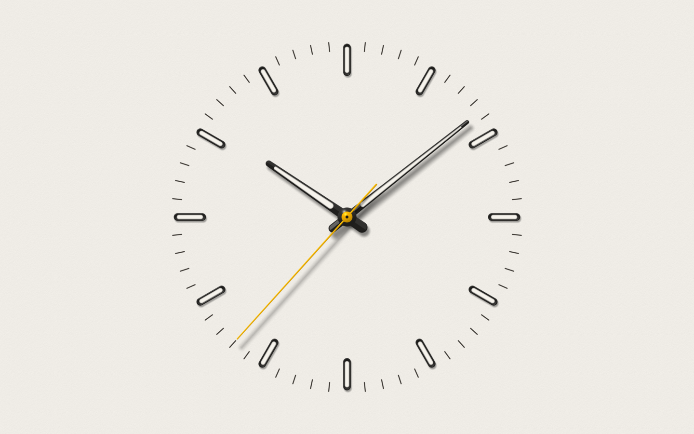
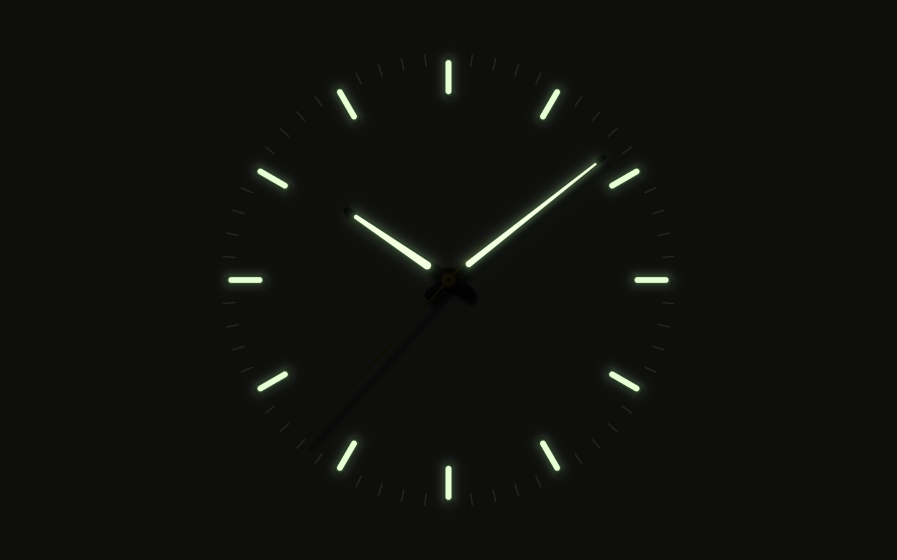

# Rams — an Omarchy theme

After Dieter Rams' work for Braun. *Weniger, aber besser.*



Rams treats the desktop like a Braun object: a neutral body, honest
materials, type that is easy to read, and one point of colour that means
something. It comes in two variants:

| | Rams | Rams Dark |
|---|---|---|
| After | SK 4, the white Braun clocks | ET 66, T 1000, the black AB 1 |
| Body | warm enamel white `#eeebe5` | charcoal `#1d1c1a` |
| Edge | charcoal `#3a3935` | aluminium `#b9b4aa` |
| Signal | Braun orange `#d4521c` | Braun orange `#f0692b` |
| Clock | paper-white lume, by day | glowing lume, by night |



## What you get

**The clock.** The desktop is a live Braun wall clock, after Rams and
Dietrich Lubs, built like a watch and drawn by a shader as an object under
one fixed light:

- **No numbers.** Twelve applied indices and a fine minute track, nothing
  else.
- **Real heights.** The indices stand off a fine pebbled dial, and the
  hands stand at three heights. Each part casts a shadow that is longer and
  softer the higher it stands.
- **One light.** The hands are lacquered, with two facets meeting at a
  ridge. The facet facing the light shines and the other goes dark, and that
  changes as the hand turns.
- **Ink is printed.** The minute track is in a deep tone of the dial
  colour, not black.
- **Day and night.** By day the lume is paper white in black frames; the
  second hand is Braun yellow. At night the lume glows and everything else
  nearly disappears.
- **Movement.**
  - On mains power, a mechanical sweep: 28,800 beats an hour, eight beats a
    second, as on a Rolex or Grand Seiko.
  - On battery, a quartz tick, one redraw a second: the stepper snaps
    forward, overshoots a hair and settles.
  - A smooth glide is an option.

The same dial appears in three places:

- **Desktop:** the `0-clock` wallpaper, the default. `omarchy theme bg next`
  or double-click the desktop for the others.
- **Screensaver:** while Omarchy's screensaver runs, it shows the night dial
  with a mechanical sweep, drifting slowly against burn-in. Input passes
  straight through to the stock screensaver, so dismissing and locking
  behave as usual.
- **Lock screen:** the dial replaces the blurred wallpaper, and the password
  field becomes a slim slot below the hub.

**Bar instruments.** The bar's status icons (battery, volume, microphone,
wifi, Bluetooth, monitor, indicators, power profiles) are redrawn as Braun
instruments in *Rams Instruments*, a small icon font in this repo:

- Levels are counted in segments, like a Braun meter.
- Inactive parts are hairlines rather than dimmed.
- Charging is a single indicator dot.
- Power profiles are one dial with the needle left, up or right.

**ET 66 calculator.** A pocket calculator after the Braun ET 66, drawn by
a shader under the same light as the clock:

- a matte, finely textured body;
- an LCD in a recessed window under glass;
- round keys standing off the body, with chamfered rims and dished tops;
  pressed keys sink and their shadows shorten;
- an orange clear key and the yellow equals key.

 Open it with `SUPER + ALT + C`, the calculator key, or
"Calculator" in the launcher; it takes the keyboard (Escape closes, Ctrl+C
copies). Omarchy's own calculator, Omacalc, only takes a theme's four base
colours, so on Rams the launcher's Calculator entry points at the ET 66
instead (`omacalc` still runs it). It works the way the real
one does: 2 + 3 × 4 = 20.

**Everything else follows the same rules:**

- **Colour is a signal.** Structure is grey. Orange marks the one thing that
  is focused, selected or active. Red means an error.
- **Honest surfaces.** Windows, menus, popups and the lock field are opaque:
  no blur or shadows, and hairline edges.
- **One radius.** 6px everywhere.
- **Calm motion.** One ease-out curve, short durations, no overshoot.
- **Type does the work.**
  - ABC Areal Mono for terminals, bar and menus; ABC Areal for GTK apps,
    Obsidian and window group tabs.
  - A short type scale, and tooltips inverted like the labels on a Braun
    control.
- **Quiet code.** Neovim, VS Code, Obsidian and pi colour code the same way:
  - mostly ink, with keywords set apart by weight rather than hue;
  - strings green, numbers orange, types brown;
  - no italics.
- **GTK** apps get the orange accent.

Leaving Rams undoes what it changed. Your previous fonts, GTK accent and
calculator key come back, and the clock and bar icons go away.

## Install

1. **Fonts.** ABC Areal is a commercial Dinamo typeface and is **not** in
   this repo. Its licence forbids putting it in public repositories. Install
   your licensed copy:

   ```bash
   mkdir -p ~/.local/share/fonts/ABCAreal
   cp ~/Downloads/ABCAreal/ABC\ Areal*/TTF/*.ttf ~/.local/share/fonts/ABCAreal/
   fc-cache -f
   ```

   Without it, the clock and calculator fall back to Inter or Noto Sans, and
   the typography hook leaves your fonts alone.

2. **Everything else:**

   ```bash
   git clone https://github.com/benjaminsehl/omarchy-rams.git ~/.local/share/omarchy-rams
   ~/.local/share/omarchy-rams/install.sh            # or --no-lock for the stock lock screen
   omarchy theme set rams                             # or rams-dark
   ```

`install.sh` links the themes to the clone, installs the plugins and the
icon font, sets up the lock screen and installs the hook. It is safe to
re-run. A plain `omarchy theme install` would only give you the palette,
shell and wallpapers: Omarchy drops Lua from themes installed that way, and
it doesn't install plugins or hooks.

### Clock options

Optional, in `~/.config/omarchy-rams/clock.json` (reloads live):

```json
{
  "movement": "auto",
  "screensaverMovement": "auto",
  "screensaverDark": true,
  "size": "classic",
  "seconds": true,
  "screensaver": true
}
```

- `movement`: `auto` (mechanical on mains, quartz on battery), `quartz`,
  `mechanical` or `smooth`.
- `size`: `classic` fills the screen's height; `compact` sits in the middle.
- To see the screensaver dial now, run `omarchy-shell braunClock preview`
  (click to close).

## How it's put together

| Path | What it is |
|---|---|
| `colors.toml` | Palette. Terminals, Chromium, keyboard RGB, helix etc. are generated from it |
| `hyprland.lua` | Borders, radius, opacity, motion, group tabs, ET 66 keys |
| `shell.toml` | Every Omarchy shell surface |
| `neovim.lua`, `vscode-theme.json`, `obsidian.css`, `pi.json`, `btop.theme` | Editor and tool themes |
| `backgrounds/` | The clock, SK 4 grille, T 3 perforation, ET 66 keys, the motto set in Areal |
| `extras/braun-clock/` | `sehl.braun-clock`: `shaders/dial.frag` (the object), `Dial.qml` (time, palette, printing), `Service.qml` (desktop, screensaver, IPC). `./build.sh` compiles the shader |
| `extras/lock/patch-lockview.py` | Patches a clone of `omarchy.lock`. Only its view changes; PAM and auth stay stock |
| `extras/instruments/RamsInstruments.otf` | The bar icon font |
| `extras/et66/` | `sehl.et66`, the calculator: `shaders/et66.frag`, `./build.sh` |
| `hooks/rams-typography.sh` | theme-set hook: fonts, icon font, GTK accent on and off with the theme |
| `tools/build.py` | Regenerates the per-variant files above from `colors.toml` |
| `tools/render-dial/` | Renders `0-clock.png` from `Dial.qml`: `RAMS_REPO=$PWD qs -p tools/render-dial` |
| `tools/wallpapers.py` | The other wallpapers (needs `rsvg-convert` and Areal) |
| `tools/instruments.py` | Builds the icon font: `uv run --with fonttools tools/instruments.py` |

The dark variant lives in `variants/dark/`, with the same files.

Notes for hacking on it:

- After editing a plugin, run `omarchy restart shell`. The shell's hot
  reload can keep a cached copy.
- `omarchy hook install` copies the hook, so re-run `install.sh` after
  editing it.
- The lock screen is a clone, so it won't pick up Omarchy's future changes
  to the stock lock view. After an Omarchy update that touches the lock,
  re-clone it:

  ```bash
  omarchy plugin disable $USER.lock && rm -r ~/.config/omarchy/plugins/$USER.lock && ./install.sh
  ```

  The patch refuses to apply if the stock view has changed shape. In that
  case you keep the stock lock screen.

## Uninstall

Switch to another theme first, so the hook restores your fonts and accent.
Then:

```bash
omarchy plugin disable sehl.braun-clock; omarchy plugin disable sehl.et66
omarchy plugin disable $USER.lock        # restores the stock lock screen
rm ~/.config/omarchy/plugins/{sehl.braun-clock,sehl.et66}
rm -r ~/.config/omarchy/plugins/$USER.lock
rm ~/.config/omarchy/themes/rams ~/.config/omarchy/themes/rams-dark
rm ~/.config/omarchy/hooks/theme-set.d/rams-typography.sh
rm -r ~/.local/share/fonts/RamsInstruments && fc-cache -f
```

## Licence

MIT, for the code, configuration, wallpapers and the Rams Instruments font.
ABC Areal is not included. Dieter Rams, Dietrich Lubs and Braun are named
for attribution only; this project isn't affiliated with them.
